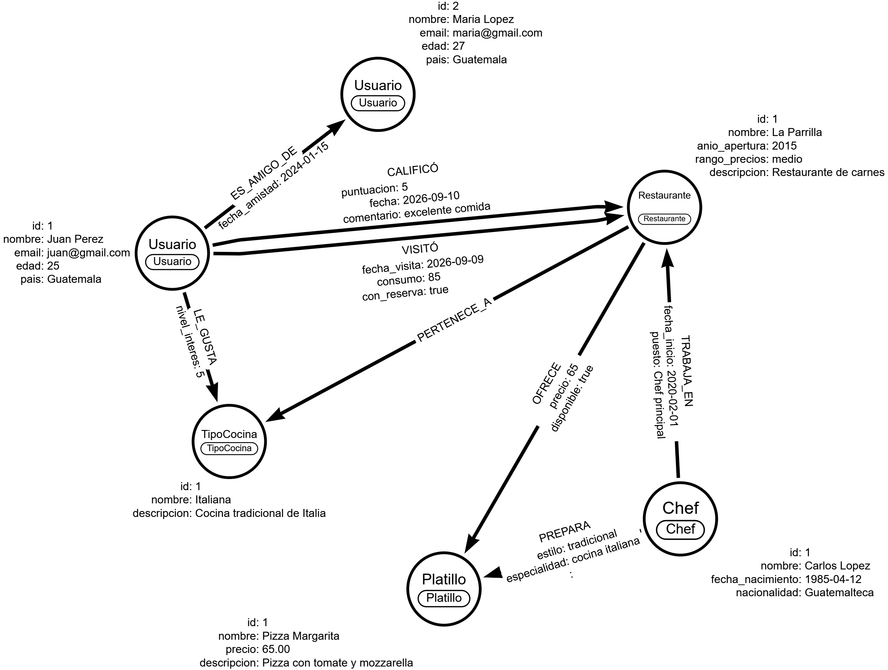

# Documentación Técnica
## Sistema de Recomendación de Restaurantes con Neo4j

**Universidad de San Carlos de Guatemala**  
**Facultad de Ingeniería**  
**Ingeniería en Ciencias y Sistemas**  
**Curso:** Sistemas de Bases de Datos 2  
**Carné:** 202202072

---

# 1. Introducción

El presente proyecto consiste en el diseño e implementación de un sistema de recomendación de restaurantes utilizando Neo4j como motor de base de datos orientado a grafos.

El sistema permite representar las relaciones entre usuarios, restaurantes, tipos de cocina, chefs y platillos. Mediante estas conexiones se pueden realizar recomendaciones considerando amistades, calificaciones, visitas y preferencias gastronómicas.

La implementación aprovecha el lenguaje Cypher para recorrer múltiples niveles de relaciones, realizar consultas de agregación y aplicar análisis de redes.

# 2. Objetivos

## 2.1 Objetivo general

Diseñar e implementar una base de datos de grafos en Neo4j que permita generar recomendaciones de restaurantes y analizar las relaciones entre los diferentes elementos de una plataforma gastronómica.

## 2.2 Objetivos específicos

- Diseñar un modelo conceptual de grafos con cinco tipos de nodos y ocho tipos de relaciones.
- Implementar restricciones e índices que contribuyan a mantener la integridad de la información.
- Generar e importar datos masivos mediante archivos CSV y consultas Cypher.
- Implementar cinco consultas para resolver los requerimientos del negocio.
- Aplicar algoritmos de análisis de redes para identificar conexiones y rutas entre usuarios.
- Documentar la implementación, validaciones y resultados obtenidos.

# 3. Tecnologías utilizadas

| Tecnología | Versión | Utilización |
|---|---|---|
| Neo4j Database | 5.26.19 | Motor de base de datos de grafos |
| Neo4j Desktop | 2.2.1 | Administración de instancia local |
| Neo4j Query | Integrado | Ejecución y visualización de consultas |
| Cypher | Neo4j 5 | Definición, carga y consultas |
| Python | 3.12.10 | Generación y validación de CSV |
| Arrows.app | Aplicación web | Modelado conceptual |
| Visual Studio Code | 1.141.0 | Desarrollo de scripts |
| Git y GitHub | Control de versiones | Respaldo del código fuente |

# 4. Modelo conceptual del grafo

El modelo utiliza cinco etiquetas principales de nodos:

1. Usuario
2. Restaurante
3. TipoCocina
4. Chef
5. Platillo

Estos nodos se conectan mediante ocho tipos de relaciones, permitiendo representar las interacciones sociales y gastronómicas.

## 4.1 Diagrama conceptual

El diagrama fue diseñado en Arrows.app e incluye ejemplos de instancias con sus propiedades y direcciones de relación.

## 4.2 Nodos y propiedades

### Usuario

Representa a las personas registradas en la plataforma.

| Propiedad | Tipo | Descripción |
|---|---|---|
| id | INTEGER | Identificador único |
| nombre | STRING | Nombre del usuario |
| email | STRING | Correo electrónico |
| edad | INTEGER | Edad |
| pais | STRING | País de residencia |

### Restaurante

Representa los establecimientos gastronómicos.

| Propiedad | Tipo | Descripción |
|---|---|---|
| id | INTEGER | Identificador único |
| nombre | STRING | Nombre comercial |
| anio_apertura | INTEGER | Año de apertura |
| rango_precios | STRING | bajo, medio o alto |
| descripcion | STRING | Descripción del restaurante |

### TipoCocina

Representa las categorías gastronómicas.

| Propiedad | Tipo | Descripción |
|---|---|---|
| id | INTEGER | Identificador único |
| nombre | STRING | Nombre de la cocina |
| descripcion | STRING | Descripción de la categoría |

### Chef

Representa a los profesionales encargados de la preparación de platillos.

| Propiedad | Tipo | Descripción |
|---|---|---|
| id | INTEGER | Identificador único |
| nombre | STRING | Nombre del chef |
| fecha_nacimiento | DATE | Fecha de nacimiento |
| nacionalidad | STRING | Nacionalidad |

### Platillo

Representa las preparaciones gastronómicas.

| Propiedad | Tipo | Descripción |
|---|---|---|
| id | INTEGER | Identificador único |
| nombre | STRING | Nombre del platillo |
| precio | FLOAT | Precio de referencia |
| descripcion | STRING | Descripción del platillo |

# 5. Relaciones del modelo

| Relación | Origen | Destino | Propiedades |
|---|---|---|---|
| CALIFICÓ | Usuario | Restaurante | puntuacion, fecha, comentario |
| VISITÓ | Usuario | Restaurante | id_visita, fecha_visita, consumo, con_reserva |
| ES_AMIGO_DE | Usuario | Usuario | fecha_amistad |
| PERTENECE_A | Restaurante | TipoCocina | Sin propiedades |
| OFRECE | Restaurante | Platillo | precio, disponible |
| PREPARA | Chef | Platillo | estilo, especialidad |
| TRABAJA_EN | Chef | Restaurante | fecha_inicio, puesto |
| LE_GUSTA | Usuario | TipoCocina | nivel_interes |

## 5.1 Consideraciones del modelado

La relación ES_AMIGO_DE representa una amistad conceptualmente bidireccional. Aunque Neo4j almacena relaciones dirigidas, las consultas sociales recorren las amistades en ambos sentidos.

La relación VISITÓ permite registrar múltiples visitas entre el mismo usuario y restaurante. Cada visita tiene un identificador propio, fecha, consumo y estado de reserva.

La relación OFRECE utiliza una única relación por combinación restaurante-platillo, evitando duplicados.

Las relaciones CALIFICÓ y LE_GUSTA utilizan valores numéricos de 1 a 5.

# 6. Implementación física

## 6.1 Instancia utilizada

La implementación se realizó mediante una instancia local de Neo4j Desktop.

**Instancia:** BD2_Proyecto2_Restaurantes  
**Base de datos:** neo4j  
**Versión del motor:** 5.26.19

## 6.2 Restricciones e índices

Se implementaron seis restricciones de unicidad:

- usuario_id_unico
- usuario_email_unico
- restaurante_id_unico
- tipococina_id_unico
- chef_id_unico
- platillo_id_unico

Adicionalmente se crearon dos índices:

- idx_restaurante_nombre
- idx_tipococina_nombre

Las restricciones permiten evitar identificadores duplicados. La restricción sobre el correo electrónico también evita registrar usuarios con correos repetidos.

Los índices por nombre facilitan búsquedas de restaurantes y tipos de cocina.

El código de creación se encuentra en:

`cypher/modelo/01_constraints_indices.cypher`

# 7. Generación y carga masiva de datos

## 7.1 Generación de datos

Se desarrollaron generadores en Python que producen archivos CSV reproducibles utilizando semillas fijas.

Los archivos utilizados son:

- scripts/generar_nodos.py
- scripts/generar_relaciones.py
- scripts/validar_datos.py

Los datos son sintéticos y fueron diseñados para permitir la evaluación de todas las consultas obligatorias.

## 7.2 Cantidades de nodos

| Tipo | Registros |
|---|---:|
| Usuario | 500 |
| Restaurante | 200 |
| Chef | 100 |
| Platillo | 50 |
| TipoCocina | 15 |
| **Total** | **865** |

## 7.3 Cantidades de relaciones

| Relación | Registros |
|---|---:|
| CALIFICÓ | 5607 |
| VISITÓ | 5616 |
| ES_AMIGO_DE | 663 |
| PERTENECE_A | 227 |
| OFRECE | 679 |
| PREPARA | 301 |
| TRABAJA_EN | 213 |
| LE_GUSTA | 997 |
| **Total** | **14303** |

## 7.4 Procedimiento de importación

La carga fue realizada mediante LOAD CSV WITH HEADERS y MERGE, utilizando los scripts:

- cypher/carga/01_cargar_nodos.cypher
- cypher/carga/02_cargar_relaciones.cypher

Primero se cargaron los nodos y posteriormente las relaciones.

Se emplearon conversiones toInteger(), toFloat() y date() para almacenar los valores con los tipos adecuados.

Para la carga de relaciones se utilizó CALL ... IN TRANSACTIONS OF 500 ROWS, permitiendo procesar los registros por lotes.

## 7.5 Validación de integridad

Se verificaron las siguientes condiciones:

- Cumplimiento de cantidades mínimas de nodos.
- Existencia de las ocho clases de relaciones.
- Referencias válidas entre nodos.
- Ausencia de identificadores duplicados de nodos.
- Calificaciones dentro del rango permitido.
- Ausencia de ofertas duplicadas entre restaurantes y platillos.
- Identificadores únicos para las visitas.

El resultado de la carga fue de 865 nodos y 14303 relaciones.

# 8. Convenciones y decisiones de diseño

Los nodos utilizan etiquetas en singular y CamelCase. Las relaciones se identifican mediante nombres en mayúsculas.

Los identificadores numéricos permiten la aplicación de MERGE y restricciones de unicidad.

Los rangos de precios utilizados para la simulación son:

| Categoría | Consumo de referencia |
|---|---:|
| bajo | Q60.00 |
| medio | Q120.00 |
| alto | Q240.00 |

Estos montos son valores definidos para los datos sintéticos del proyecto y no corresponden a tarifas oficiales.

Las consultas de recomendación social consideran hasta tres grados de amistad y excluyen restaurantes visitados previamente.

Para el análisis de restaurantes altamente conectados se considera destacado un platillo preparado por al menos un chef y ofrecido por tres o más restaurantes distintos.

---

# 9. Consultas Cypher implementadas

Se desarrollaron cinco consultas de negocio utilizando Cypher y las relaciones definidas en el modelo de grafos.

Cada consulta cuenta con un archivo independiente dentro de `cypher/consultas/`, lo que facilita su ejecución, mantenimiento y validación.

## 9.1 Consulta 1: Recomendación social

**Archivo:** `cypher/consultas/01_recomendacion_social.cypher`

### Objetivo

Recomendar restaurantes a un usuario tomando como referencia las calificaciones realizadas por sus amigos directos e indirectos, considerando hasta tres grados de separación.

### Funcionamiento

La consulta utiliza recorridos de longitud variable mediante `ES_AMIGO_DE*1..3`, permitiendo encontrar usuarios conectados hasta el tercer nivel de amistad.

Posteriormente, obtiene restaurantes que estos usuarios calificaron con una puntuación igual o superior a cuatro estrellas.

Los restaurantes visitados previamente por el usuario consultado quedan excluidos de las recomendaciones.

Los resultados se ordenan por cantidad de amigos coincidentes y promedio de calificaciones.

### Resultados obtenidos

Usuario utilizado: Juan Perez (ID 1).

| Restaurante | Amigos coincidentes | Calificación promedio |
|---|---:|---:|
| Bistro Italiana 016 | 3 | 5.00 |
| Bistro Italiana 031 | 3 | 4.00 |

Los restaurantes fueron recomendados por:

- Maria Lopez: primer grado de amistad.
- Lucia Pineda: segundo grado de amistad.
- Valeria Torres: tercer grado de amistad.

### Interpretación

Los resultados demuestran que Neo4j permite utilizar las relaciones sociales para generar recomendaciones personalizadas.

La Parrilla, restaurante previamente visitado por Juan Perez, fue correctamente excluido de las recomendaciones.

Esto permite sugerir nuevos establecimientos basándose en experiencias positivas de personas relacionadas dentro del grafo.

## 9.2 Consulta 2: Chefs de alto impacto

**Archivo:** `cypher/consultas/02_chefs_alto_impacto.cypher`

### Objetivo

Identificar chefs que trabajan en restaurantes con calificación promedio superior a cuatro estrellas y que preparan platillos ofrecidos en al menos tres restaurantes distintos.

### Funcionamiento

Se recorren las relaciones `TRABAJA_EN`, `CALIFICÓ`, `PREPARA` y `OFRECE`.

Mediante funciones de agregación se calculan las calificaciones promedio de los restaurantes y la cantidad de establecimientos que ofrecen cada platillo.

### Resultados obtenidos

Caso de prueba: Carlos Lopez (ID 1).

| Indicador | Resultado |
|---|---:|
| Restaurantes bien calificados | 2 |
| Calificación de La Parrilla | 5.00 |
| Calificación de Bistro Italiana 031 | 4.19 |
| Platillos que cumplen el requisito | 4 |
| Restaurantes que ofrecen Pizza Margarita | 14 |

### Interpretación

Carlos Lopez cumple ambas condiciones, ya que trabaja en restaurantes con buenas valoraciones y prepara platillos disponibles en múltiples establecimientos.

El análisis permite identificar chefs con presencia gastronómica relevante a partir de su participación en diferentes restaurantes y platillos.

## 9.3 Consulta 3: Restaurantes infravalorados

**Archivo:** `cypher/consultas/03_restaurantes_infravalorados.cypher`

### Objetivo

Identificar restaurantes cuya tasa de visitas con reserva sea superior a la tasa global, pero cuya calificación promedio sea inferior al promedio general de la plataforma.

### Funcionamiento

La consulta calcula de forma independiente las estadísticas de visitas y calificaciones para evitar multiplicaciones de registros.

Posteriormente, compara cada restaurante con los indicadores globales.

### Resultados obtenidos

Caso de prueba: Mesa China 050 (ID 50).

| Indicador | Resultado |
|---|---:|
| Visitas registradas | 28 |
| Visitas con reserva | 28 |
| Tasa de reservas | 100.00% |
| Tasa global de reservas | 42.24% |
| Calificación del restaurante | 1.50 |
| Calificación global | 3.80 |

### Interpretación

Mesa China 050 presenta una tasa de reservas superior al promedio general, pero sus calificaciones son considerablemente inferiores.

De acuerdo con la definición establecida por el proyecto, cumple las condiciones para ser considerado un restaurante infravalorado.

Este análisis permite identificar diferencias entre el comportamiento de reservas y la satisfacción expresada mediante calificaciones.

## 9.4 Consulta 4: Rango de precios frente al consumo real

**Archivo:** `cypher/consultas/04_precios_vs_consumo.cypher`

### Objetivo

Comparar el consumo promedio registrado durante las visitas con el consumo esperado según el rango de precios declarado por cada restaurante.

### Funcionamiento

La consulta utiliza las propiedades `rango_precios` de Restaurante y `consumo` de la relación VISITÓ.

Se calcula el promedio real, la diferencia monetaria y la desviación porcentual.

Los resultados se ordenan según la diferencia absoluta para identificar los casos con mayores desviaciones.

### Resultados obtenidos

Caso de prueba: Mesa Arabe 075 (ID 75).

| Indicador | Resultado |
|---|---:|
| Rango de precios | Alto |
| Visitas registradas | 28 |
| Consumo esperado | Q240.00 |
| Consumo promedio real | Q600.21 |
| Diferencia monetaria | +Q360.21 |
| Diferencia porcentual | +150.09% |

### Interpretación

El consumo promedio del restaurante supera en un 150.09% el valor de referencia definido para su categoría.

Esto demuestra que el rango de precios declarado y el gasto real de los usuarios pueden presentar diferencias importantes.

Los resultados permiten analizar patrones de consumo y detectar establecimientos cuyo comportamiento económico difiere de lo esperado.

## 9.5 Consulta 5: Preferencias declaradas frente al comportamiento real

**Archivo:** `cypher/consultas/05_discrepancias_cocinas.cypher`

### Objetivo

Encontrar usuarios cuyas preferencias gastronómicas declaradas no coincidan con los tipos de cocina que visitan más frecuentemente.

### Funcionamiento

Se utiliza la relación `LE_GUSTA` para identificar las cocinas con mayor nivel de interés declarado.

Después, se recorren las relaciones `VISITÓ` y `PERTENECE_A` para calcular la frecuencia de visitas por tipo de cocina.

Finalmente, se comparan ambos resultados para identificar discrepancias.

La consulta también contempla situaciones de empate entre cocinas preferidas o visitadas.

### Resultados obtenidos

Caso de prueba: Diego Castillo (ID 10).

| Indicador | Resultado |
|---|---|
| Cocina preferida declarada | Italiana |
| Nivel de interés | 5 |
| Cocina más visitada | Mexicana |
| Frecuencia de visitas mexicanas | 15 |
| Resultado | Discrepancia detectada |

### Interpretación

Diego Castillo declara que su cocina favorita es la italiana, pero sus visitas muestran una mayor frecuencia de consumo de cocina mexicana.

Esto demuestra que las preferencias expresadas explícitamente no siempre coinciden con el comportamiento real.

La consulta permite identificar diferencias que pueden utilizarse para comprender mejor los hábitos gastronómicos de los usuarios.

---

# 10. Análisis de redes

Se implementaron dos análisis utilizando las conexiones almacenadas en Neo4j.

## 10.1 Ruta más corta entre usuarios

**Archivo:** `cypher/analisis/01_ruta_mas_corta.cypher`

### Objetivo

Determinar la cantidad mínima de relaciones de amistad necesarias para conectar dos usuarios.

### Funcionamiento

Se utiliza la función `shortestPath()` sobre las relaciones ES_AMIGO_DE, considerando ambos sentidos de la amistad.

El resultado incluye los usuarios involucrados y la cantidad de grados de separación.

### Resultados obtenidos

Usuario origen: Juan Perez (ID 1).

Usuario destino: Valeria Torres (ID 4).

Ruta encontrada:

Juan Perez -> Maria Lopez -> Lucia Pineda -> Valeria Torres

**Distancia mínima: 3 grados de separación.**

### Interpretación

Neo4j identificó una ruta de tres relaciones entre los usuarios seleccionados.

Este tipo de análisis permite conocer la proximidad entre integrantes de una red social y comprender cómo se conectan las personas mediante amistades directas e indirectas.

## 10.2 Restaurantes altamente conectados

**Archivo:** `cypher/analisis/02_restaurantes_conectados.cypher`

### Objetivo

Identificar restaurantes que presentan una mayor cantidad de conexiones con chefs y platillos destacados.

### Funcionamiento

Se cuentan los chefs vinculados mediante TRABAJA_EN y los platillos ofrecidos mediante OFRECE.

Para este análisis se define como destacado un platillo preparado por al menos un chef y ofrecido en tres o más restaurantes.

La puntuación de conectividad se calcula sumando:

Puntuación = Cantidad de chefs + Cantidad de platillos destacados

### Resultados obtenidos

Restaurante mejor posicionado: Bistro Italiana 016 (ID 16).

| Indicador | Resultado |
|---|---:|
| Chefs vinculados | 13 |
| Platillos ofrecidos | 13 |
| Platillos destacados | 13 |
| Puntuación de conectividad | 26 |

### Interpretación

Bistro Italiana 016 obtuvo el mayor puntaje dentro de los resultados analizados.

Su cantidad de chefs y platillos destacados refleja una mayor conectividad gastronómica respecto a otros restaurantes de la plataforma.

Esta métrica permite identificar establecimientos que mantienen numerosas relaciones relevantes dentro del grafo.

---

# 11. Ventajas de utilizar Neo4j

## 11.1 Representación natural de relaciones

Neo4j permite representar directamente las relaciones entre usuarios, restaurantes, platillos, chefs y tipos de cocina.

Las conexiones forman parte del modelo de datos y pueden recorrerse mediante Cypher.

## 11.2 Consultas de múltiples niveles

Las recomendaciones sociales requieren encontrar usuarios conectados a través de diferentes grados de amistad.

Neo4j permite expresar estos recorridos mediante patrones de longitud variable sin construir manualmente cadenas de uniones entre tablas.

## 11.3 Flexibilidad del modelo

El modelo puede incorporar nuevas propiedades o tipos de relaciones sin necesidad de rediseñar una estructura completa de tablas relacionales.

## 11.4 Análisis de redes

La función shortestPath permite calcular rutas entre usuarios, mientras que los recorridos y agregaciones permiten analizar la conectividad entre restaurantes, chefs y platillos.

## 11.5 Consultas orientadas al negocio

Cypher facilita expresar preguntas de negocio utilizando patrones cercanos a la estructura conceptual del problema.

Esto permite relacionar las necesidades del sistema con los recorridos que deben realizarse dentro del grafo.

---

# 12. Validaciones realizadas

Durante el desarrollo se verificaron las siguientes condiciones:

| Validación | Resultado |
|---|---|
| Cantidad de nodos cargados | 865 |
| Cantidad de relaciones cargadas | 14303 |
| Tipos de nodos | 5 |
| Tipos de relaciones | 8 |
| Constraints de unicidad | 6 |
| Índices de búsqueda adicionales | 2 |
| Cinco consultas obligatorias | Ejecutadas correctamente |
| Ruta más corta | Validada |
| Restaurantes altamente conectados | Validado |
| Calificaciones fuera del rango permitido | No encontradas |
| Ofertas duplicadas por restaurante y platillo | No encontradas |
| Identificadores de visitas duplicados | No encontrados |

Las validaciones se realizaron mediante consultas Cypher y el script Python `validar_datos.py`.

---

# 13. Conclusiones

1. Se implementó satisfactoriamente una base de datos de grafos utilizando Neo4j, cumpliendo las cantidades mínimas de nodos y las relaciones requeridas para el sistema de recomendación de restaurantes.

2. Las cinco consultas Cypher permitieron analizar recomendaciones sociales, impacto de chefs, restaurantes infravalorados, diferencias de consumo y discrepancias entre preferencias declaradas y comportamiento real.

3. Los análisis de redes demostraron la utilidad de los recorridos de grafos para calcular rutas mínimas entre usuarios e identificar restaurantes altamente conectados.

4. La generación reproducible mediante Python y la importación con LOAD CSV facilitaron la construcción de un conjunto de datos suficientemente amplio para demostrar los requerimientos del proyecto.

5. Neo4j proporcionó un modelo adecuado para representar y consultar las conexiones entre los distintos elementos del sistema, especialmente en operaciones que requieren recorrer múltiples relaciones.

---

# 14. Código fuente y reproducibilidad

El código fuente completo se encuentra organizado en el repositorio:

BD2_2S26_Proyectos_202202072

Dentro de la carpeta:

Segundo Proyecto

Los scripts están separados por responsabilidad:

- `cypher/modelo/`: restricciones, índices, nodos y relaciones de ejemplo.
- `cypher/carga/`: importación masiva mediante LOAD CSV.
- `cypher/consultas/`: cinco consultas obligatorias.
- `cypher/analisis/`: dos análisis de redes.
- `scripts/`: generación y validación de datos mediante Python.
- `data/`: archivos CSV utilizados durante la importación.
- `diagramas/`: modelo conceptual del grafo.

El manual de usuario presenta el procedimiento detallado para preparar el entorno, ejecutar la carga inicial y utilizar las consultas.

Los resultados descritos en este documento corresponden a la base de datos de prueba construida durante el desarrollo del proyecto.
