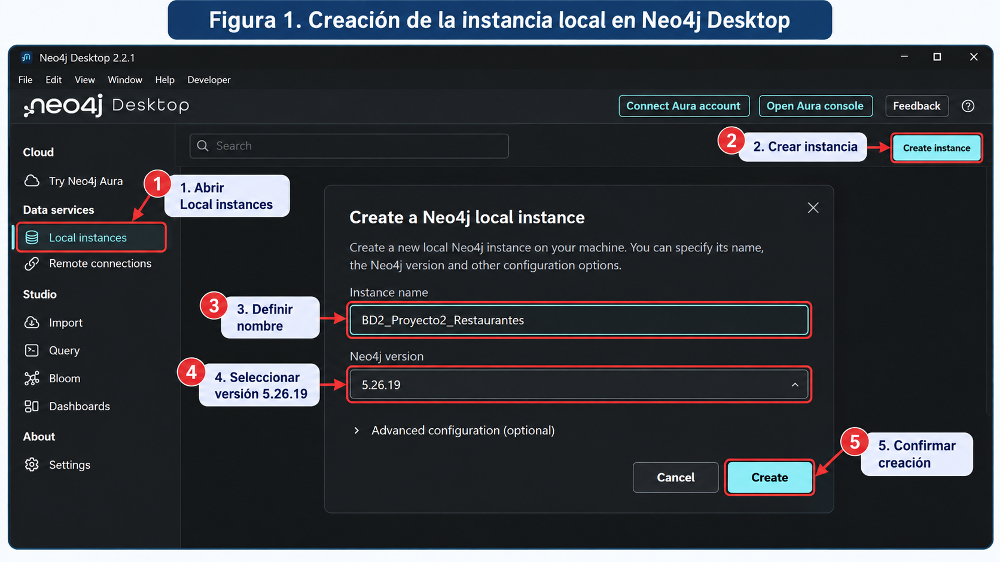
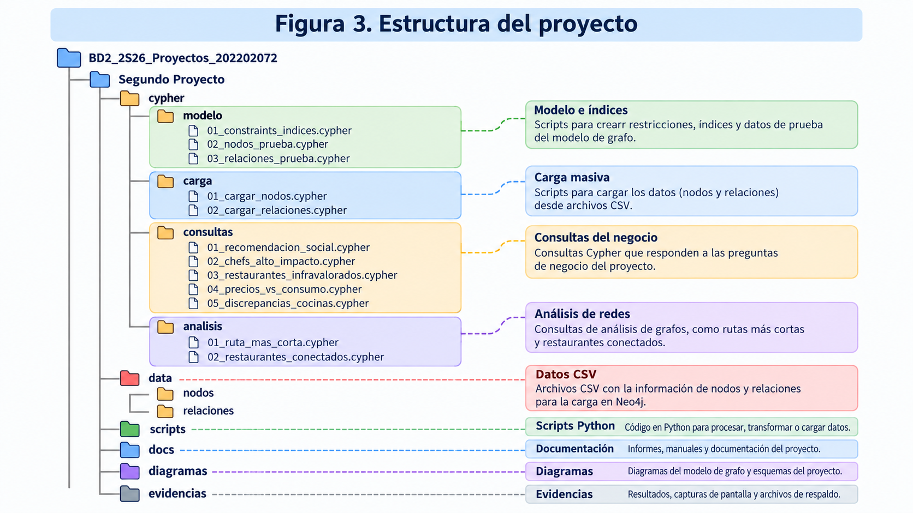
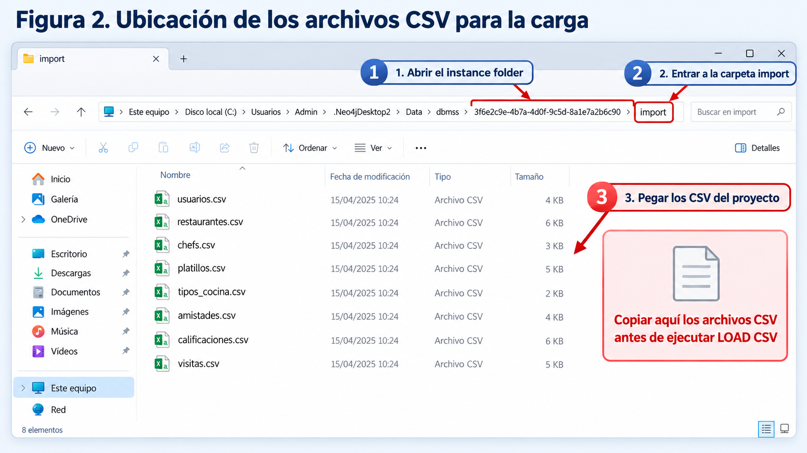
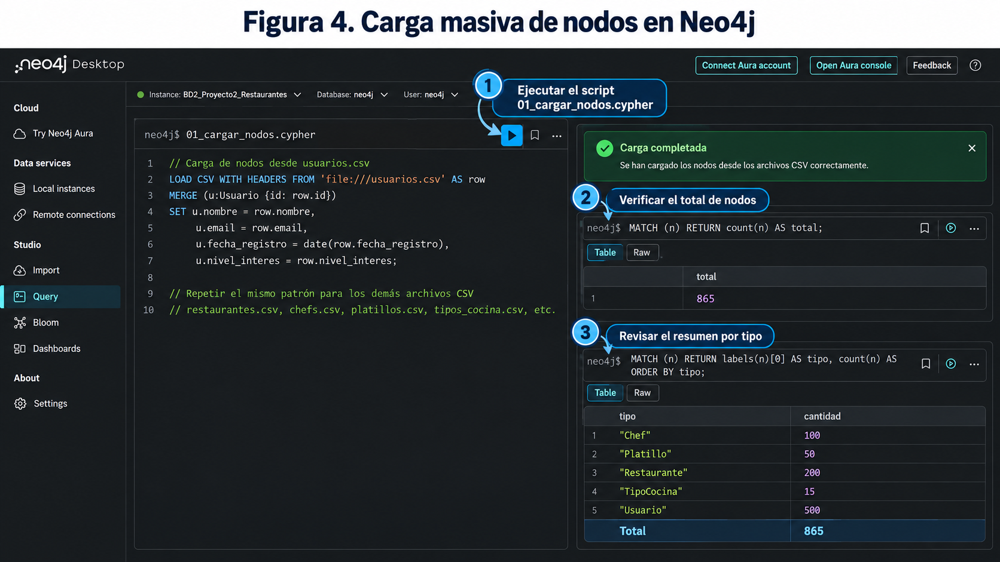
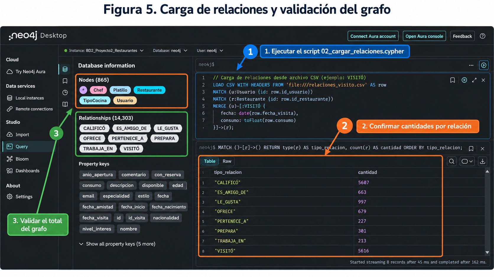
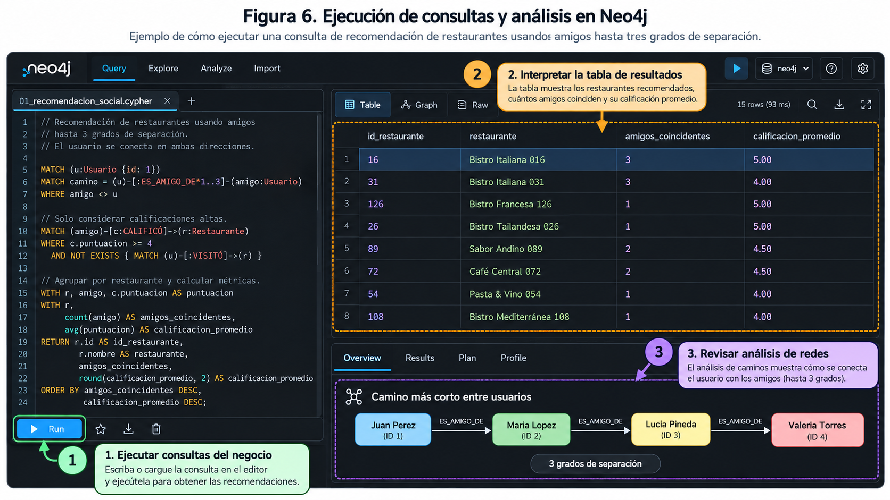

# MANUAL DE USUARIO
## Sistema de Recomendación de Restaurantes con Neo4j

**Universidad de San Carlos de Guatemala**  
**Facultad de Ingeniería — Ingeniería en Ciencias y Sistemas**  
**Curso:** Sistemas de Bases de Datos 2  
**Proyecto:** Segundo Proyecto  
**Estudiante:** Edin Rafael Santizo Barrera  
**Carné:** 202202072  
**Entorno de referencia:** Windows 11, Neo4j Desktop 2.2.1, Neo4j Database 5.26.19 y Python 3.12.10  

---

## Índice

1. Introducción y propósito del manual
2. Requisitos previos
3. Instalación y configuración de Neo4j
4. Archivos y estructura del proyecto
5. Preparación de los datos CSV
6. Creación del modelo e importación en Neo4j
7. Verificación de la base de datos
8. Ejecución de las cinco consultas de negocio
9. Ejecución de los dos análisis de redes
10. Interpretación de resultados y exportación de evidencias
11. Problemas frecuentes y soluciones
12. Buenas prácticas y reconstrucción del proyecto
13. Resumen de comandos y rutas

---

# 1. Introducción y propósito del manual

Este manual explica cómo preparar, cargar y consultar el **Sistema de Recomendación de Restaurantes con Neo4j**, desarrollado como Segundo Proyecto del curso Sistemas de Bases de Datos 2. Está dirigido a estudiantes, auxiliares y evaluadores que deban reproducir la base de datos y comprobar las consultas implementadas.

El sistema almacena cinco tipos de nodos —`Usuario`, `Restaurante`, `Chef`, `Platillo` y `TipoCocina`— conectados mediante ocho tipos de relaciones. Permite recomendar restaurantes a partir de amistades y calificaciones; identificar chefs relevantes, restaurantes infravalorados y diferencias de consumo; detectar discrepancias de preferencias; y realizar dos análisis de redes.

El conjunto de prueba validado contiene **865 nodos** y **14,303 relaciones**. Los archivos de datos son sintéticos y pueden regenerarse mediante Python.

> **Sobre las figuras:** las seis imágenes de este manual son **guías visuales ilustrativas**, no capturas exactas ni instrucciones Cypher para copiar. Algunos campos, rutas, controles o fragmentos representados gráficamente pueden simplificarse. Los **archivos `.cypher` y los comandos escritos en este manual** son la referencia para ejecutar el proyecto.

# 2. Requisitos previos

Se requiere un equipo capaz de ejecutar Neo4j localmente, acceso a los archivos del repositorio y permisos para crear una instancia y copiar archivos a su carpeta `import`.

| Componente | Versión utilizada en el proyecto | Finalidad |
|---|---|---|
| Windows | 11 Pro, 64 bits | Sistema operativo de referencia |
| Neo4j Desktop | 2.2.1 | Administración de la instancia local |
| Neo4j Database | 5.26.19 | Motor de base de datos |
| Neo4j Query | Incluido en Neo4j Desktop | Ejecución de consultas Cypher |
| Python | 3.12.10 | Generación y validación de CSV |
| Visual Studio Code | 1.141.0 | Consulta y edición de scripts |
| Git | 2.55.0 | Obtención y versionado del proyecto |

No es necesario instalar paquetes adicionales de Python para ejecutar los generadores incluidos: utilizan bibliotecas estándar.

Repositorio de GitHub:  
`https://github.com/EdinSantizo/BD2_2S26_Proyectos_202202072`

La carpeta del trabajo es **`Segundo Proyecto`**, dentro de ese repositorio.

# 3. Instalación y configuración de Neo4j

## 3.1 Obtener Neo4j Desktop

1. Ingresar al sitio oficial de Neo4j: <https://neo4j.com/download/>.
2. Descargar la edición de Neo4j Desktop adecuada para el sistema operativo.
3. Instalar y abrir la aplicación.
4. Si el programa solicita permisos del sistema o componentes complementarios, completar la configuración indicada por el instalador.

En el desarrollo se utilizó Neo4j Desktop 2.2.1. Si se utiliza otra versión, algunos controles pueden cambiar de ubicación.

## 3.2 Crear una instancia local

1. En la barra lateral, abrir **Local instances**.
2. Seleccionar **Create instance**.
3. Asignar el nombre **`BD2_Proyecto2_Restaurantes`**.
4. Seleccionar **Neo4j Database 5.26.19** cuando esté disponible.
5. Confirmar con **Create**.
6. Configurar la contraseña del usuario `neo4j` cuando el asistente la solicite y conservarla de forma segura.
7. Iniciar la instancia hasta que muestre el estado **RUNNING**.



*Figura 1. Guía ilustrativa de creación y configuración de la instancia local.*

**Importante:** la contraseña no debe guardarse en los archivos del proyecto ni subirse a GitHub.

## 3.3 Abrir Neo4j Query

1. Con la instancia en estado `RUNNING`, abrir **Query** en el menú lateral.
2. Seleccionar la instancia **`BD2_Proyecto2_Restaurantes`**.
3. Comprobar que la base seleccionada sea **`neo4j`** y el usuario sea **`neo4j`**.
4. Ejecutar la consulta de prueba:

```cypher
RETURN 'Conexion exitosa' AS estado, 1 + 1 AS prueba;
```

**Resultado esperado:** estado `Conexion exitosa` y prueba `2`.

> La edición utilizada trabaja con la base de datos `neo4j` creada por defecto. El nombre de la **instancia** no equivale al nombre de la **base de datos**.

# 4. Archivos y estructura del proyecto

## 4.1 Descargar el código

Con Git instalado, puede obtenerse el proyecto desde PowerShell:

```powershell
git clone https://github.com/EdinSantizo/BD2_2S26_Proyectos_202202072.git
cd .\BD2_2S26_Proyectos_202202072
```

Si ya se tiene el repositorio, solo es necesario abrirlo y situarse en su carpeta raíz. Los comandos PowerShell de este manual se ejecutan **desde la raíz del repositorio**, salvo que se indique lo contrario.

## 4.2 Estructura principal

```text
BD2_2S26_Proyectos_202202072/
└── Segundo Proyecto/
    ├── cypher/
    │   ├── modelo/
    │   │   ├── 01_constraints_indices.cypher
    │   │   ├── 02_nodos_prueba.cypher
    │   │   └── 03_relaciones_prueba.cypher
    │   ├── carga/
    │   │   ├── 01_cargar_nodos.cypher
    │   │   └── 02_cargar_relaciones.cypher
    │   ├── consultas/
    │   │   ├── 01_recomendacion_social.cypher
    │   │   ├── 02_chefs_alto_impacto.cypher
    │   │   ├── 03_restaurantes_infravalorados.cypher
    │   │   ├── 04_precios_vs_consumo.cypher
    │   │   └── 05_discrepancias_cocinas.cypher
    │   └── analisis/
    │       ├── 01_ruta_mas_corta.cypher
    │       └── 02_restaurantes_conectados.cypher
    ├── data/
    │   ├── nodos/              # 5 archivos CSV
    │   └── relaciones/         # 8 archivos CSV
    ├── scripts/
    │   ├── generar_nodos.py
    │   ├── generar_relaciones.py
    │   └── validar_datos.py
    ├── diagramas/
    │   ├── modelo_conceptual.json
    │   └── modelo_conceptual.png
    ├── docs/
    │   ├── documentacion_tecnica.md
    │   └── manual_usuario.md
    └── evidencias/
        └── figura_01_... a figura_06_... .png
```



*Figura 3. Distribución ilustrativa de carpetas y responsabilidades de los archivos.*

Los archivos `.cypher` están separados para permitir ejecutar cada paso y cada consulta independientemente. El modelo gráfico editable se conserva en `diagramas/modelo_conceptual.json` y su imagen en `diagramas/modelo_conceptual.png`.

# 5. Preparación de los datos CSV

## 5.1 Utilizar los CSV incluidos

El repositorio ya contiene los CSV necesarios para la carga. **No es obligatorio regenerarlos** si únicamente se desea evaluar el proyecto.

| Carpeta | Archivo | Registros esperados |
|---|---|---:|
| `data/nodos/` | `usuarios.csv` | 500 |
| `data/nodos/` | `restaurantes.csv` | 200 |
| `data/nodos/` | `chefs.csv` | 100 |
| `data/nodos/` | `platillos.csv` | 50 |
| `data/nodos/` | `tipos_cocina.csv` | 15 |
| `data/relaciones/` | `amistades.csv` | 663 |
| `data/relaciones/` | `pertenencias.csv` | 227 |
| `data/relaciones/` | `ofertas.csv` | 679 |
| `data/relaciones/` | `preparaciones.csv` | 301 |
| `data/relaciones/` | `trabajos.csv` | 213 |
| `data/relaciones/` | `gustos.csv` | 997 |
| `data/relaciones/` | `calificaciones.csv` | 5,607 |
| `data/relaciones/` | `visitas.csv` | 5,616 |

## 5.2 Regenerar los CSV (opcional)

Desde PowerShell, ubicado en la raíz del repositorio:

```powershell
python "Segundo Proyecto\scripts\generar_nodos.py"
python "Segundo Proyecto\scripts\generar_relaciones.py"
```

Los generadores utilizan semillas fijas para producir datos reproducibles. El segundo generador requiere que los CSV de nodos existan previamente.

## 5.3 Validar los datos antes de cargarlos

```powershell
python "Segundo Proyecto\scripts\validar_datos.py"
```

La última sección de la salida debe indicar:

```text
===== RESULTADO FINAL =====
Nodos: 865
Relaciones: 14303
VALIDACION COMPLETADA CORRECTAMENTE
```

Si se obtiene un `AssertionError`, revisar el mensaje antes de continuar; generalmente indica un registro duplicado, una referencia inexistente o un dato fuera del rango previsto.

## 5.4 Copiar los CSV a la carpeta `import`

`LOAD CSV` con `file:///archivo.csv` lee los archivos del directorio de importación de la **instancia local** de Neo4j, no de cualquier carpeta de Windows.

1. Ir a **Neo4j Desktop → Local instances**.
2. En la tarjeta de `BD2_Proyecto2_Restaurantes`, abrir el menú de tres puntos.
3. Elegir **Open → Instance folder**.
4. Entrar en la subcarpeta **`import`**; crearla si no existe.
5. **Copiar** —no mover— los cinco CSV de `Segundo Proyecto/data/nodos/` y los ocho de `Segundo Proyecto/data/relaciones/` a esa misma carpeta `import`.
6. Confirmar que dentro de `import` se encuentren **13 archivos CSV**.



*Figura 2. Ubicación ilustrativa de los CSV. El identificador de la carpeta de instancia varía entre equipos.*

También puede hacerse mediante PowerShell, usando **la ruta real de la carpeta `import` que se abrió**:

```powershell
$destinoImport = Read-Host "Pega la ruta completa de la carpeta import de Neo4j"

if (-not (Test-Path -LiteralPath $destinoImport -PathType Container)) {
    throw "No existe la carpeta import indicada. Revisa la ruta."
}

Copy-Item "Segundo Proyecto\data\nodos\*.csv" -Destination $destinoImport
Copy-Item "Segundo Proyecto\data\relaciones\*.csv" -Destination $destinoImport

Get-ChildItem -LiteralPath $destinoImport -Filter "*.csv" | Select-Object Name
```

Este procedimiento conserva intactos los originales almacenados en GitHub.

## 5.5 Comprobar acceso a los CSV

En Neo4j Query, ejecutar **cada consulta por separado**:

```cypher
LOAD CSV WITH HEADERS
FROM 'file:///usuarios.csv' AS row
RETURN count(row) AS usuarios_csv;
```

**Resultado esperado:** `usuarios_csv = 500`.

```cypher
LOAD CSV WITH HEADERS
FROM 'file:///visitas.csv' AS row
RETURN count(row) AS visitas_csv;
```

**Resultado esperado:** `visitas_csv = 5616`.

Estas pruebas son de solo lectura: no agregan registros al grafo.

# 6. Creación del modelo e importación en Neo4j

> **Advertencia:** para reconstruir el proyecto desde cero, lo recomendable es usar una instancia nueva o una base de datos de prueba vacía. No elimine datos de una instancia que ya esté funcionando. Los scripts de carga se diseñaron para reutilizar nodos por ID, pero eso no convierte cualquier base preexistente en un entorno seguro para pruebas destructivas.

## 6.1 Crear restricciones e índices

Abrir en VS Code:

`Segundo Proyecto/cypher/modelo/01_constraints_indices.cypher`

Copiar a Neo4j Query y ejecutar las sentencias Cypher del archivo, **una por una**, esperando la confirmación de cada una.

Se definen seis restricciones de unicidad para ID de nodos y email de usuario, junto con dos índices adicionales sobre nombres.

Para comprobar que los elementos existen:

```cypher
SHOW CONSTRAINTS;
```

```cypher
SHOW INDEXES;
```

La lista de índices puede incluir índices internos asociados a restricciones y a la instalación; no es necesario que contenga exclusivamente los dos índices adicionales.

## 6.2 Cargar nodos de prueba (opcional)

Si se desea visualizar primero el modelo pequeño, ejecutar los archivos:

1. `cypher/modelo/02_nodos_prueba.cypher`
2. `cypher/modelo/03_relaciones_prueba.cypher`

Estos crean seis nodos representativos y ocho relaciones iniciales. La visita de Juan Perez a La Parrilla está identificada con `id_visita = 1` en la versión corregida de `03_relaciones_prueba.cypher`.

**La carga de ejemplos es opcional**: también se puede importar directamente el conjunto masivo desde una base vacía con las restricciones e índices creados. En ambos casos, el resultado esperado de la carga completa es el mismo.

## 6.3 Cargar los 865 nodos

Abrir el archivo:

`Segundo Proyecto/cypher/carga/01_cargar_nodos.cypher`

Ejecutar en Neo4j Query **cada bloque `LOAD CSV` de manera independiente**, en el orden definido por el archivo. Los bloques importan:

1. Usuarios (500).
2. Restaurantes (200).
3. Tipos de cocina (15).
4. Chefs (100).
5. Platillos (50).

Cada bloque utiliza `MERGE` y conversiones `toInteger()`, `toFloat()` o `date()` según el tipo de dato. Si antes se cargaron los seis nodos de ejemplo, estos se reutilizan en lugar de duplicarse.



*Figura 4. Esquema ilustrativo de importación y verificación de nodos. Ejecutar el código real de `01_cargar_nodos.cypher`, no el código decorativo de la figura.*

Verificar el total:

```cypher
MATCH (n)
RETURN labels(n)[0] AS tipo_nodo,
       count(n) AS cantidad
ORDER BY tipo_nodo;
```

**Resultados esperados:** `Chef=100`, `Platillo=50`, `Restaurante=200`, `TipoCocina=15`, `Usuario=500`.

## 6.4 Cargar las 14,303 relaciones

Abrir:

`Segundo Proyecto/cypher/carga/02_cargar_relaciones.cypher`

Ejecutar los **ocho bloques por separado**, en este orden:

1. `ES_AMIGO_DE` — `amistades.csv`.
2. `PERTENECE_A` — `pertenencias.csv`.
3. `OFRECE` — `ofertas.csv`.
4. `PREPARA` — `preparaciones.csv`.
5. `TRABAJA_EN` — `trabajos.csv`.
6. `LE_GUSTA` — `gustos.csv`.
7. `CALIFICÓ` — `calificaciones.csv`.
8. `VISITÓ` — `visitas.csv`.

Las sentencias agrupan la carga en transacciones de 500 filas mediante `CALL (row) { ... } IN TRANSACTIONS OF 500 ROWS`. Ejecutarlas como consultas independientes y dejar que termine cada una antes de pasar a la siguiente.

La relación `VISITÓ` emplea un identificador `id_visita` para permitir varias visitas entre un mismo usuario y restaurante sin duplicar la visita original de prueba.



*Figura 5. Esquema ilustrativo del procedimiento de carga de relaciones y del resumen del grafo; los nombres exactos de CSV y patrones Cypher válidos están en los archivos del repositorio.*

# 7. Verificación de la base de datos

## 7.1 Total de nodos

```cypher
MATCH (n)
RETURN count(n) AS total_nodos;
```

**Esperado:** `865`.

## 7.2 Total de relaciones

```cypher
MATCH ()-[r]->()
RETURN count(r) AS total_relaciones;
```

**Esperado:** `14303`.

## 7.3 Conteo por relación

```cypher
MATCH ()-[r]->()
RETURN type(r) AS tipo_relacion,
       count(r) AS cantidad
ORDER BY tipo_relacion;
```

| Relación | Cantidad esperada |
|---|---:|
| `CALIFICÓ` | 5,607 |
| `ES_AMIGO_DE` | 663 |
| `LE_GUSTA` | 997 |
| `OFRECE` | 679 |
| `PERTENECE_A` | 227 |
| `PREPARA` | 301 |
| `TRABAJA_EN` | 213 |
| `VISITÓ` | 5,616 |

## 7.4 Comprobaciones de integridad

Calificaciones fuera de rango:

```cypher
MATCH ()-[c:`CALIFICÓ`]->()
WHERE c.puntuacion IS NULL OR c.puntuacion < 1 OR c.puntuacion > 5
RETURN count(c) AS calificaciones_invalidas;
```

**Esperado:** `0`.

Platillos ofrecidos de forma duplicada por un mismo restaurante:

```cypher
MATCH (r:Restaurante)-[o:OFRECE]->(p:Platillo)
WITH r, p, count(o) AS cantidad
WHERE cantidad > 1
RETURN r.id AS restaurante, p.id AS platillo, cantidad;
```

**Esperado:** ninguna fila.

Identificadores de visitas nulos o repetidos:

```cypher
MATCH ()-[v:`VISITÓ`]->()
WITH v.id_visita AS id_visita, count(v) AS cantidad
WHERE id_visita IS NULL OR cantidad > 1
RETURN id_visita, cantidad;
```

**Esperado:** ninguna fila.

## 7.5 Visualizar una muestra del grafo

Para evitar mostrar miles de nodos de una vez:

```cypher
MATCH (u:Usuario {id: 1})-[r]-(n)
RETURN u, r, n
LIMIT 30;
```

Si la interfaz lo permite, seleccionar **Graph** para explorar visualmente las relaciones del usuario de ejemplo.

# 8. Ejecución de las cinco consultas de negocio

En todas las consultas, abrir el archivo indicado en VS Code, copiar el **Cypher ejecutable** a Neo4j Query, presionar el botón de ejecución y revisar la vista **Table**. Los ejemplos siguientes corresponden al conjunto de datos sintéticos incluido.



*Figura 6. Vista ilustrativa de edición, ejecución e interpretación de resultados. Los valores y fragmentos decorativos de la imagen no sustituyen los resultados devueltos por Neo4j.*

## 8.1 Consulta 1 — Recomendación social hasta tres grados

**Archivo:** `cypher/consultas/01_recomendacion_social.cypher`  
**Usuario de prueba:** Juan Perez (`id=1`).

**Cómo ejecutarla:**

1. Abrir el archivo indicado.
2. Verificar que el primer `MATCH` utilice `Usuario {id: 1}`.
3. Ejecutar la consulta completa y observar las columnas de restaurante, amigos coincidentes, calificación promedio y amigos que recomiendan.

**Resultados principales validados:**

| Restaurante | Amigos coincidentes | Calificación promedio |
|---|---:|---:|
| Bistro Italiana 016 | 3 | 5.00 |
| Bistro Italiana 031 | 3 | 4.00 |

**Interpretación:** tres personas a una, dos y tres relaciones de amistad de Juan aportaron calificaciones favorables. La consulta da prioridad a coincidencias sociales y calificaciones altas. `La Parrilla` no se recomienda porque Juan ya la visitó.

**Personalización:** cambiar el `id` del usuario en el primer `MATCH` para consultar recomendaciones de otro usuario; el resultado puede variar o estar vacío.

## 8.2 Consulta 2 — Chefs de alto impacto

**Archivo:** `cypher/consultas/02_chefs_alto_impacto.cypher`.

**Cómo ejecutarla:** copiar todo el archivo en Neo4j Query y ejecutar. Revisar las columnas de chefs, cantidad de restaurantes bien calificados y cantidad de platillos ofrecidos en tres o más establecimientos.

**Caso de prueba:** Carlos Lopez (`id=1`) trabaja en dos restaurantes que superan una calificación promedio de cuatro estrellas y prepara cuatro platillos que cumplen el criterio de distribución. La Parrilla tiene promedio `5.00`; Pizza Margarita se ofrece en `14` restaurantes.

**Interpretación:** un chef aparece porque cumple **ambas** condiciones, no solo porque prepara muchos platillos o porque un restaurante recibió una valoración individual elevada.

## 8.3 Consulta 3 — Restaurantes infravalorados

**Archivo:** `cypher/consultas/03_restaurantes_infravalorados.cypher`.

**Cómo ejecutarla:** copiar y ejecutar el archivo. Observar las tasas de reserva local y global, y las calificaciones local y global.

**Caso validado:** Mesa China 050 (`id=50`).

| Indicador | Valor |
|---|---:|
| Visitas totales | 28 |
| Visitas con reserva | 28 |
| Tasa de reserva del restaurante | 100.00 % |
| Tasa global de reservas | 42.24 % |
| Calificación del restaurante | 1.50 |
| Calificación global | 3.80 |

**Interpretación:** el restaurante cumple el criterio utilizado: **mayor tasa de reservas que la plataforma, pero menor calificación promedio**. La etiqueta «infravalorado» en este proyecto responde a esta definición matemática, no a una evaluación externa del establecimiento.

## 8.4 Consulta 4 — Rango de precios frente al consumo real

**Archivo:** `cypher/consultas/04_precios_vs_consumo.cypher`.

**Cómo ejecutarla:** copiar y ejecutar. Revisar `consumo_esperado`, `consumo_promedio_real`, diferencia monetaria y diferencia porcentual.

**Valores de referencia para los datos sintéticos:** rango bajo `Q60`, medio `Q120` y alto `Q240`.

**Caso validado:** Mesa Arabe 075 (`id=75`), rango alto, con `28` visitas, consumo esperado `Q240.00`, consumo real promedio `Q600.21`, diferencia `Q360.21` y desviación `+150.09 %`.

**Interpretación:** el consumo promedio es muy superior al esperado para la categoría declarada. Los valores esperados son supuestos del generador, **no precios oficiales del mercado**.

## 8.5 Consulta 5 — Discrepancia entre preferencias y visitas

**Archivo:** `cypher/consultas/05_discrepancias_cocinas.cypher`.

**Cómo ejecutarla:** copiar y ejecutar el archivo completo. La salida contiene el usuario, las cocinas favoritas declaradas, las cocinas más visitadas y su frecuencia.

**Caso validado:** Diego Castillo (`id=10`) declara cocina **Italiana** con nivel de interés `5`, pero la cocina más frecuentada en su historial es **Mexicana**, con `15` visitas.

**Interpretación:** el sistema detecta una diferencia entre lo declarado y lo observado. Si varias cocinas empatan en preferencia o frecuencia, la consulta compara todos los valores empatados para evitar falsos positivos.

# 9. Ejecución de los dos análisis de redes

## 9.1 Ruta más corta entre usuarios

**Archivo:** `cypher/analisis/01_ruta_mas_corta.cypher`.

El archivo utiliza `shortestPath()` para calcular la menor cantidad de relaciones de amistad entre los usuarios `id=1` y `id=4`.

**Ruta validada:**

```text
Juan Perez (1)
    -> Maria Lopez (2)
    -> Lucia Pineda (3)
    -> Valeria Torres (4)
```

**Resultado:** `3` grados de separación.

En Neo4j Query puede seleccionarse **Graph** para visualizar la ruta devuelta en el campo `ruta_grafo`. Para probar otros casos, sustituir los valores `id` de `origen` y `destino` en el archivo.

## 9.2 Restaurantes altamente conectados

**Archivo:** `cypher/analisis/02_restaurantes_conectados.cypher`.

La consulta cuenta los chefs vinculados a cada restaurante y sus platillos destacados. En este análisis, un platillo se considera destacado si está preparado por al menos un chef y se ofrece en tres o más restaurantes.

**Caso validado:** Bistro Italiana 016 (`id=16`), con `13` chefs, `13` platillos ofrecidos, `13` destacados y **puntaje de conectividad `26`**.

**Interpretación:** el puntaje es una métrica propia del proyecto (`número de chefs + número de platillos destacados`), útil para ordenar restaurantes por su cantidad de relaciones relevantes; no corresponde a una calificación de usuarios.

# 10. Interpretación de resultados y exportación de evidencias

## 10.1 Vistas de resultados

En Neo4j Query, los resultados pueden mostrarse como tabla, vista sin formato y, cuando se devuelven nodos o caminos, como grafo. Las consultas de negocio normalmente se interpretan mejor en **Table**. Para el análisis de ruta más corta también conviene revisar **Graph**.

Si se ven fechas, edades u otros valores dentro de los círculos en lugar de nombres, es una decisión de visualización y no indica que la carga esté incorrecta.

## 10.2 Exportar una consulta

1. Ejecutar la consulta deseada.
2. Confirmar que los resultados tengan las columnas y cantidades esperadas.
3. Utilizar la opción de descarga/exportación de resultados disponible en la interfaz para guardar JSON o CSV, según las opciones mostradas.
4. Guardar el archivo exportado dentro de `Segundo Proyecto/evidencias/`, con un nombre que identifique la consulta, por ejemplo `consulta_01_recomendacion_social.json`.
5. Si se solicita evidencia visual, guardar una captura en la misma carpeta, distinguiéndola de las seis **imágenes ilustrativas** del manual.

## 10.3 Interpretar correctamente los resultados

- Los promedios de calificaciones se expresan en la escala de 1 a 5 estrellas.
- Las tasas de reserva se muestran en porcentajes cuando el alias de salida así lo indica.
- Las diferencias de consumo se expresan en quetzales (`Q`) y porcentajes.
- Los grados de separación se miden en **cantidad de relaciones** recorridas.
- Los resultados dependen del conjunto de datos cargado. Si se añaden o eliminan registros, las cifras y clasificaciones pueden cambiar.

# 11. Problemas frecuentes y soluciones

| Problema | Posible causa | Solución recomendada |
|---|---|---|
| `LOAD CSV` indica archivo inexistente | CSV copiado a la carpeta raíz de la instancia y no a `import` | Abrir **Open → Instance folder**, entrar en `import` y copiar allí los CSV |
| `LOAD CSV` devuelve menos filas | Archivo CSV incorrecto, encabezados diferentes o conjunto de datos modificado | Revisar que estén los 13 archivos originales y regenerar/validar CSV si es necesario |
| No se puede conectar a `neo4j` | Instancia apagada o credenciales incorrectas | Comprobar estado **RUNNING**, instancia y usuario seleccionados |
| Restricción de unicidad fallida | Datos conflictivos ya existentes | Revisar identificadores y emails; no eliminar restricciones sin investigar el conflicto |
| Consulta devuelve 0 filas | Faltan nodos/relaciones o el ID de ejemplo no existe | Verificar totales y ejecutar primero las cargas masivas |
| Error de transacciones en la importación | Bloque `IN TRANSACTIONS` ejecutado en una transacción explícita | Ejecutar el bloque por separado en modo de transacción implícita; revisar el mensaje y la ayuda de Query antes de reintentar |
| Error de sintaxis cerca de `WHERE` | Se colocó `WHERE` inmediatamente después de cerrar `CALL` sin `WITH` | Utilizar la versión corregida de `05_discrepancias_cocinas.cypher` incluida en el repositorio |
| Aparecen fechas o números en los nodos del gráfico | Estilo de presentación seleccionado por la herramienta | Cambiar el estilo o etiqueta de visualización; no altera los datos |
| Faltan las imágenes en el manual | Archivos no extraídos en la ruta indicada | Comprobar que existan los seis PNG dentro de `Segundo Proyecto/evidencias/` con los nombres exactos usados por Markdown |
| Git no muestra una carpeta vacía | Git no conserva directorios sin archivos | Agregar su contenido real; no es necesario restaurar `.gitkeep` |

**Si una carga se interrumpe:** revisar los registros ya importados y el error antes de repetirla. `MERGE` ayuda a evitar duplicaciones en las claves previstas, pero no sustituye la validación de integridad del conjunto completo.

# 12. Buenas prácticas y reconstrucción del proyecto

## 12.1 Orden resumido de reconstrucción desde una instancia nueva

1. Clonar o descargar el repositorio.
2. Crear e iniciar la instancia Neo4j 5.26.19.
3. Ejecutar `generar_nodos.py` y `generar_relaciones.py` **solo si** se necesita regenerar los CSV.
4. Ejecutar `validar_datos.py`.
5. Copiar los trece archivos CSV a `import`.
6. Comprobar acceso a `usuarios.csv` y `visitas.csv` con `LOAD CSV` de solo lectura.
7. Ejecutar `01_constraints_indices.cypher`.
8. Opcionalmente ejecutar `02_nodos_prueba.cypher` y `03_relaciones_prueba.cypher` para visualizar el modelo mínimo.
9. Ejecutar por bloques `01_cargar_nodos.cypher`.
10. Ejecutar por bloques `02_cargar_relaciones.cypher`.
11. Confirmar **865 nodos y 14,303 relaciones** y realizar verificaciones de integridad.
12. Ejecutar las cinco consultas de negocio y los dos análisis de redes.

Este procedimiento está documentado para reproducir el proyecto. **No reemplaza una prueba automatizada integral realizada desde cero**; si la evaluación exige demostrar esa reconstrucción, debe llevarse a cabo en una instancia nueva y conservar sus evidencias.

## 12.2 Conservar los archivos originales

No editar los CSV de muestra con herramientas que alteren separadores, formato numérico o codificación sin volver a validarlos. Mantener los originales en `data/nodos` y `data/relaciones` y usar la carpeta `import` como ubicación de copias de trabajo.

## 12.3 Credenciales y control de versiones

No publicar contraseñas, configuraciones privadas ni archivos `.env` con secretos. Los archivos fuente y la documentación se almacenan en GitHub; los datos activos de Neo4j permanecen en la instancia local.

# 13. Resumen de comandos y rutas

## 13.1 Scripts Python

Desde la raíz del repositorio:

```powershell
python "Segundo Proyecto\scripts\generar_nodos.py"
python "Segundo Proyecto\scripts\generar_relaciones.py"
python "Segundo Proyecto\scripts\validar_datos.py"
```

## 13.2 Scripts Cypher, en orden de carga

```text
cypher/modelo/01_constraints_indices.cypher
cypher/modelo/02_nodos_prueba.cypher          (opcional)
cypher/modelo/03_relaciones_prueba.cypher     (opcional)
cypher/carga/01_cargar_nodos.cypher
cypher/carga/02_cargar_relaciones.cypher
```

## 13.3 Consultas de negocio

```text
cypher/consultas/01_recomendacion_social.cypher
cypher/consultas/02_chefs_alto_impacto.cypher
cypher/consultas/03_restaurantes_infravalorados.cypher
cypher/consultas/04_precios_vs_consumo.cypher
cypher/consultas/05_discrepancias_cocinas.cypher
```

## 13.4 Análisis de redes

```text
cypher/analisis/01_ruta_mas_corta.cypher
cypher/analisis/02_restaurantes_conectados.cypher
```

## 13.5 Verificación final rápida

```cypher
MATCH (n) RETURN count(n) AS total_nodos;
```

Resultado esperado: **865**.

```cypher
MATCH ()-[r]->() RETURN count(r) AS total_relaciones;
```

Resultado esperado: **14,303**.

---

**Fin del manual de usuario.**  
**Sistema de Recomendación de Restaurantes con Neo4j — Segundo Proyecto — Sistemas de Bases de Datos 2.**
